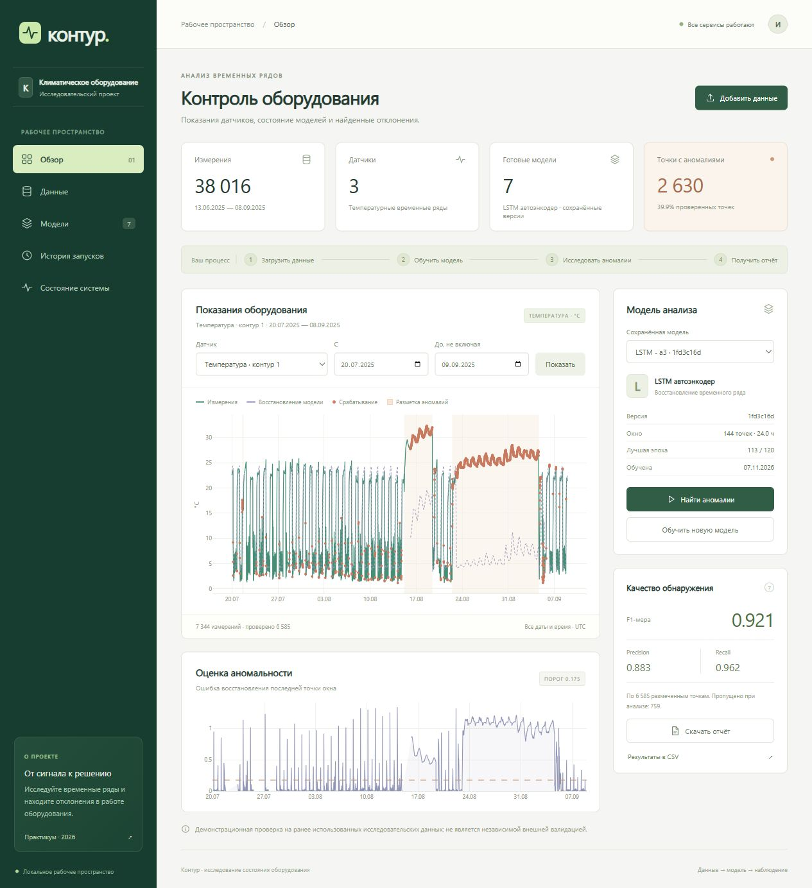
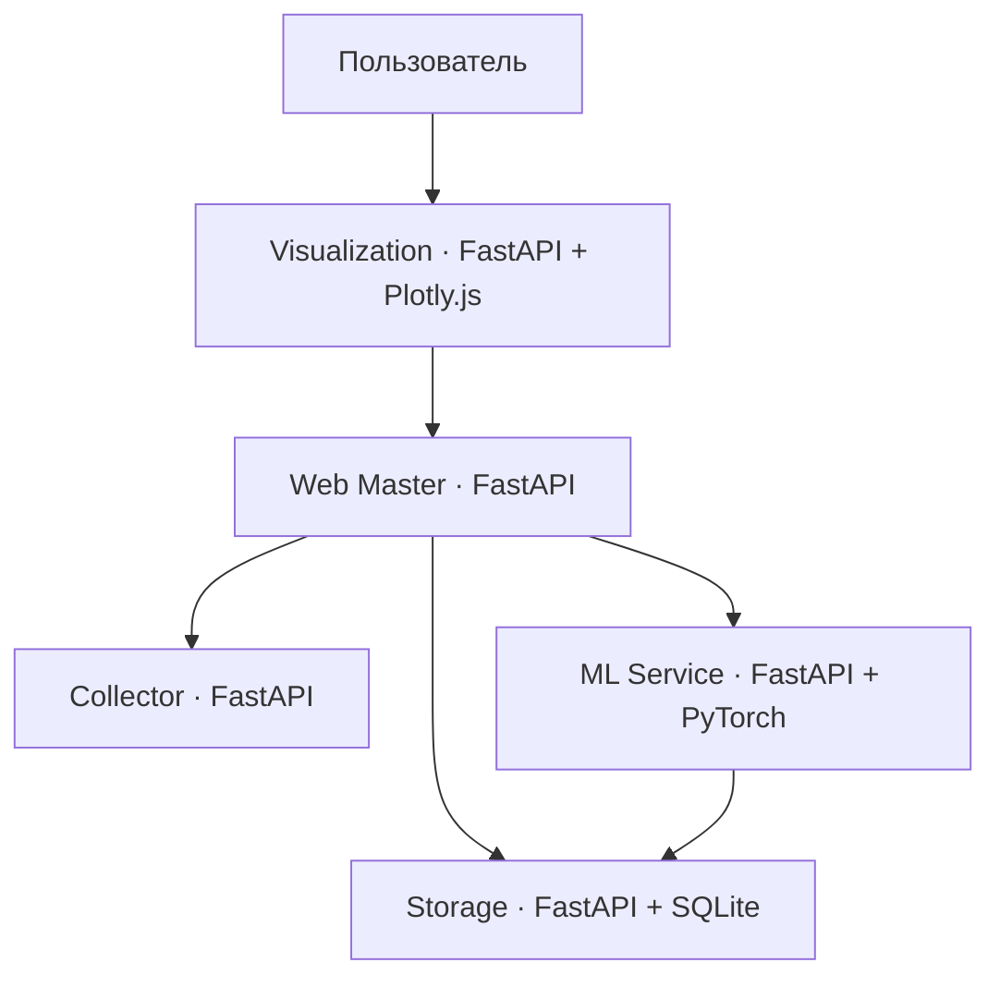

# Контур — аномалии в показаниях оборудования

Индивидуальный проект по построению микросервисной системы для поддержки исследовательской работы. Пользователь загружает временные ряды, обучает LSTM-автоэнкодер, исследует аномалии на другом периоде и получает отчёт.



Промежуточная проверка: **8 ноября 2026**. Окончательная сдача: **8 декабря 2026**.

## Быстрый запуск в Windows

1. Установите Docker Desktop с поддержкой Linux-контейнеров.
2. Запустите **`start.cmd`**. Он при необходимости запускает Docker Desktop, собирает пять образов и поднимает систему. При первой сборке нужен интернет для загрузки зависимостей, включая CPU-версию PyTorch. После сборки работа с демоданными и графиками не требует интернета.
3. Откройте **http://127.0.0.1:8050** — браузер также открывается автоматически.
4. Нажмите **«Добавить данные» → «Демонстрационный набор IQDS»**.
5. Выберите датчик и нажмите **«Обучить новую модель»**. Для демоданных подходят значения по умолчанию.
6. После завершения обучения нажмите **«Найти аномалии»**.
7. Скачайте HTML-отчёт или CSV с результатами.

Остановка: **`stop.cmd`**. Проверка состояния: **`status.cmd`**. Данные, модели и история сохраняются после остановки и повторного запуска.

Автоматическая демонстрация всех трёх датчиков: **`demo.cmd`** после запуска системы. Она использует уже готовые совместимые модели либо обучает новые и проверяет выгрузку отчётов.

### Запуск из терминала

```powershell
powershell -NoProfile -File scripts/build.ps1
docker compose up --no-build -d --wait
docker compose ps
docker compose logs --tail 50
docker compose down
```

В Windows с Docker Compose 5.1.1 общая сборка Bake из пути с кириллицей может выдавать ошибку `x-docker-expose-session-sharedkey`. `scripts/build.ps1` обходит её индивидуальной сборкой образов и сохраняет кэш слоёв. На системах без этой ошибки доступен обычный `docker compose up --build -d --wait`.

Порты можно изменить через `.env`: скопируйте `.env.example`. Адреса внутренних сервисов и параметры модели заданы в `configs/*.json`, Docker переопределяет внутренние адреса переменными окружения. Исходные абсолютные пути к исследовательской папке для запуска не нужны.

## Задача и сценарии

Целевой пользователь — исследователь или инженер, анализирующий температурные показания оборудования.

1. **Загрузка и просмотр данных.** Получить порции измерений из Collector или загрузить собственный CSV, увидеть датчики, период и пропуски.
2. **Обучение модели.** Выбрать датчик, периоды, длину окна и число эпох; обучить и сохранить отдельную версию модели.
3. **Обнаружение аномалий.** Применить сохранённую модель к последующему периоду и изучить сигнал, реконструкцию, оценки и срабатывания.
4. **Оценка и отчёт.** Сравнить результат с разметкой, если она есть, скачать автономный HTML-отчёт и CSV.
5. **История.** Открыть сохранённый запуск без повторного обучения и получить его отчёт.

## Архитектура



| Сервис | Ответственность | Локальный адрес |
| --- | --- | --- |
| Collector | Источники, пакеты последовательных записей, журнал загрузок | http://127.0.0.1:8101/docs |
| Storage | CRUD наборов и измерений, SQLite, результаты и история | http://127.0.0.1:8102/docs |
| ML Service | Создание, фоновое обучение, summary, применение и версии моделей | http://127.0.0.1:8103/docs |
| Web Master | API пользовательских сценариев и отчётов | http://127.0.0.1:8104/docs |
| Visualization | Веб-интерфейс, интерактивные графики и прокси к Web Master | http://127.0.0.1:8050 |

Каждый сервис — отдельный контейнер со своим Dockerfile, конфигурацией JSON, `/health`, API и журналом `requests.jsonl`. Порты опубликованы только на loopback. Storage является единственным владельцем SQLite; другие сервисы получают данные через HTTP. ML Service отдельно владеет весами и метаданными моделей.

Интерфейс реализован на Python/FastAPI с HTML/CSS/JavaScript и локальной копией Plotly.js. Готовые MLOps-платформы и внешние сервисы для работы приложения не используются.

## Данные

В репозиторий включена демонстрационная производная локального исследовательского набора IQDS:

- исходные измерения: 426 638 строк в `mv_cond_temperature.csv`;
- исходная разметка: 426 638 строк в `labled_mv_cond.csv`;
- три датчика температуры;
- демонстрационная копия: **38 016 строк**, 13 июня — 8 сентября 2025 года;
- шаг 10 минут; значения — среднее, разметка — максимум в интервале **(t − 10 минут, t]**;
- метка времени — **правый край интервала**, всё время в UTC;
- 126 пропущенных значений и столько же неизвестных меток сохранены явно;
- характеристики и SHA-256 исходных файлов и копии: `data/demo_manifest.json`.

Исходные файлы не изменяются. Повторная подготовка копии при наличии оригиналов:

```powershell
python scripts/prepare_demo.py "путь к папке с исходными CSV"
```

### Собственный CSV

UTF-8, разделитель — запятая. Обязательные столбцы: `timestamp,sensor,value`; необязательный — `label` (0 — норма, 1 — аномалия). Пример формата: `visualization/static/sample.csv`. Это только образец структуры; трёх строк недостаточно для обучения.

```csv
timestamp,sensor,value,label
2025-06-13T00:00:00Z,temperature-1,23.5,0
2025-06-13T00:10:00Z,temperature-1,23.7,0
```

Пустое значение или метка трактуется как пропуск. Имена датчиков: буквы, цифры, пробел, `_`, `-`, `.`. Повтор пары «датчик, время», нечисловые/бесконечные значения и неверная разметка отклоняются. Даты без часового пояса интерпретируются как UTC. Максимум: 15 МБ и 100 000 строк в наборе. Автоматического усреднения загружаемого CSV нет: подавайте регулярный временной ряд нужной частоты.

## Модель и корректность оценки

Архитектура адаптирована из исследовательского `lstm_autoencoder.py`: LSTM-кодировщик, латентный вектор, LSTM-декодировщик с координатами позиции. Основной score — квадрат ошибки реконструкции **последней точки** прошлого окна в нормализованном масштабе.

По умолчанию:

- обучение: `[2025-06-13, 2025-06-22)`;
- первые 80% длительности обучающего периода — обучение, последующие 20% — валидация с непересекающимися окнами;
- нормализация median/IQR только по обучающей части;
- лучшая эпоха выбирается по ошибке валидации;
- настройка порога: `[2025-06-22, 2025-06-29)`, квантиль 0.99 ошибок нормальных окон;
- демонстрационная проверка: `[2025-07-20, 2025-09-09)`;
- окно 144 точки (24 часа для демоданных), 120 эпох, hidden=32, latent=8, seed=42, CPU.

Все концы периодов не включаются. При наличии разметки для обучения и калибровки используются окна, полностью состоящие из известных нормальных точек. Без разметки пользователь предполагает, что выбранный период нормальный. Окна с пропусками и разрывами регулярного шага исключаются. При анализе разрешён только прошлый контекст перед началом периода. Период анализа должен начинаться не раньше конца калибровки.

Результат включает precision, recall, F1, F0.5, F2, AP, ROC AUC и TP/FP/FN/TN, если соответствующие метрики определены. Метрики вычисляются только по размеченным точкам с доступным score. При отсутствии разметки качество не выдумывается. История содержит также число пропущенных и проверенных точек.

Это демонстрация на ранее использованных исследовательских периодах, **не независимая внешняя валидация**. Метрики данной адаптации не заменяют результаты исходного исследования. Измеряется обнаружение аномалий; заблаговременность предупреждения относительно начала неисправности здесь не оценивается.

Каждое обучение создаёт новую версию с весами, параметрами нормализации, порогом, историей потерь, seed и SHA-256 обучающего снимка. Изменение измерений исходного набора после обучения требует новой модели. Перезапуск во время обучения помечает незавершённую модель как прерванную.

## Структура

```text
collector/         Сборщик и Dockerfile
storage/           API хранилища и Dockerfile
ml_service/        Модель, обучение, API и Dockerfile
web_master/        Пользовательские сценарии, отчёты и Dockerfile
visualization/     Веб-приложение, локальные ресурсы и Dockerfile
common/            Проверки входных данных, конфигурация, журналирование
configs/           JSON-конфигурации пяти сервисов
data/              Демонстрационные данные и происхождение
scripts/           Сборка, запуск и автоматическая демонстрация
tests/             Проверки корректности данных, модели и хранилища
docs/              API, отчёт и сценарий защиты
docker-compose.yml Пять сервисов, связи, healthcheck, постоянные тома
```

## Проверки

Тесты: Python 3.13, зависимости из `requirements.txt`, `ml_service/requirements.txt`, `torch==2.7.1`, `pytest`. Для разработки допустим `python scripts/local.py`; это дополнительный режим, сдача демонстрируется в Docker.

```powershell
python -m pytest
python scripts/demo.py --all-sensors --output output/verification
```

Проверяются причинность score, отсутствие влияния проверочного периода на обучение/порог, обработка разрывов и пропусков, корректность метрик, CRUD и сохранение SQLite. `scripts/demo.py` проходит загрузку, обучение, анализ и скачивание двух форматов через Web Master.

Подробности: `docs/API.md`, `docs/REPORT.md`, `docs/DEMO.md`. Фактические результаты проверки собранной версии: `docs/VALIDATION.md`.

## GitHub

Код и документация подготовлены к размещению в репозитории. `.gitignore` исключает локальное окружение, журналы, временные файлы, сохранённые пользовательские данные и результаты запусков. Исходный PDF задания не нужен для запуска. Автоматическая публикация в удалённый репозиторий не выполняется.

## За рамками первой версии

Авторизация и роли, внешние источники данных, несколько типов моделей и автоматизация GitHub Actions могут быть добавлены к декабрьской сдаче. Фоновый исполнитель ограничен одним заданием обучения/анализа одновременно; очередь и тяжёлая MLOps-платформа не требуются для локальной демонстрации.
